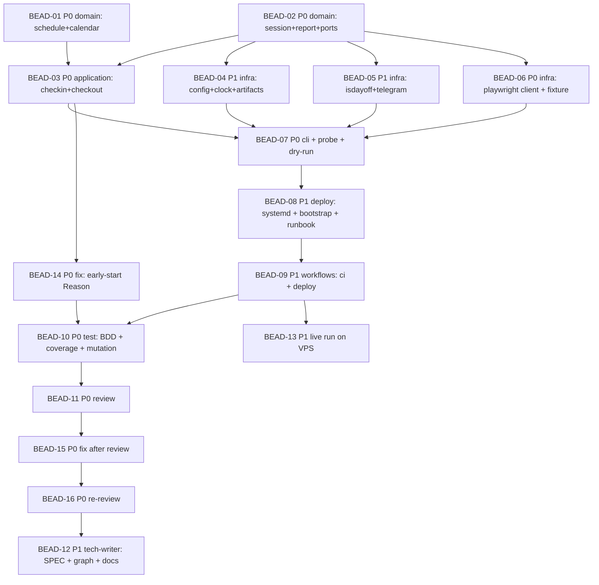

# PLAN: HT-001 — Automatic check-in and check-out of Horizon VDI

> **Status:** Approved
> **Created:** 2026-10-20

---

**Parent bead:** ht-jz5

## Epic Description

Build the whole service on the empty skeleton: the pure decision core, the use cases, the adapters
(Playwright, isdayoff, Telegram, config, clock), the CLI, the systemd timers, CI and auto-deploy to
the VPS; then the BDD suite over the PRD scenarios, the review, the AS-IS documentation and the first live run
from the VPS by the owner's hand.

## Dependency DAG

**Critical path:** BEAD-02 → BEAD-06 → BEAD-07 → BEAD-08 → BEAD-09 → BEAD-10 → BEAD-11 → BEAD-12

**Waves** (the file areas do not overlap inside a wave, so the beads of a wave run
in parallel; `beadloom waves` confirms it before the launch):

| Wave | Beads | Shared files |
|-------|-------|-------------|
| 1 | BEAD-01, BEAD-02 | none: `domain/schedule.py`+`calendar.py` against `session.py`+`report.py`+`ports.py` |
| 2 | BEAD-03, BEAD-04, BEAD-05, BEAD-06 | none: one package or module per bead; `pyproject.toml` is edited only by BEAD-06 (pytest-playwright is not needed: the fixture is served by `http.server`) |
| 3 | BEAD-07 | `cli.py`, `application/probe.py` |
| 4 | BEAD-08, then BEAD-09 | `deploy/`, then `.github/workflows/` |
| 5 | BEAD-10 → BEAD-11 → BEAD-12; BEAD-13 in parallel after BEAD-09 | roles |

## Beads

Status lives in ACTIVE.md, reconciled from the tracker by the pre-commit active-sync, so this
table names the plan and carries no status. The Tracker cell holds `-` until the beads are
created, and then the id the tracker answered.

| ID | Tracker | Name | Priority | Depends On |
|----|---------|------|----------|------------|
| BEAD-01 | ht-0x2 | Domain: the run window and the calendar verdict | P0 | - |
| BEAD-02 | ht-6sc | Domain: session state, report, ports | P0 | - |
| BEAD-03 | ht-0jm | Application: the checkin and checkout use cases | P0 | 01, 02 |
| BEAD-04 | ht-c5q | Infrastructure: config, clock, artifacts | P1 | 02 |
| BEAD-05 | ht-axc | Infrastructure: the isdayoff and Telegram adapters | P1 | 02 |
| BEAD-06 | ht-xlh | Infrastructure: the Playwright Horizon client and the markup fixture | P0 | 02 |
| BEAD-07 | ht-oqx | CLI: composition root, probe, dry-run | P0 | 03, 04, 05, 06 |
| BEAD-08 | ht-2h2 | Deploy: systemd units, bootstrap, RUNBOOK | P1 | 07 |
| BEAD-09 | ht-spa | Workflows: CI and auto-deploy to the VPS | P1 | 08 |
| BEAD-10 | ht-1ex | Test: the BDD suite over the PRD, coverage, the core's mutation gate | P0 | 09 |
| BEAD-11 | ht-9uk | Review: quality, boundaries, secret safety | P0 | 10 |
| BEAD-12 | ht-6rw | Tech-writer: feature nodes of the graph, SPEC.md, layer READMEs, the CLI doc | P1 | 11 |
| BEAD-13 | ht-bl6 | Live run on the VPS by the owner's hand | P1 | 09 |
| BEAD-14 | ht-jz5.1 | Domain: a reason for a start before the window (fix, found by BEAD-03) | P0 | 02, 03 |
| BEAD-15 | ht-jz5.2 | Fix after the review: the coverage threshold in CI and five minors | P0 | 11 |
| BEAD-16 | ht-jz5.3 | Re-review after BEAD-15 | P0 | 15 |

## Bead Details

### BEAD-01: Domain: the run window and the calendar verdict

**Priority:** P0
**Depends on:** -
**Blocks:** BEAD-03

**What to do:**
`domain/schedule.py`: `Window` (start and end in local time), `RunKind`
(CHECKIN, CHECKOUT), `Decision` (RUN, RETRY, SKIP_LATE, SKIP_NON_WORKING_DAY) and
`decide(now, window, verdict, attempt, policy)`; `RetryPolicy(max_attempts, backoff)`.
`domain/calendar.py`: `WorkingDayVerdict(is_working, source)` with the sources CALENDAR and
WEEKDAY_FALLBACK, `weekday_rule(date)`, `resolve(calendar_answer, date)`. Time only as
an argument. TDD: first the tests of the window boundaries (07:54:59, 07:55:00, 08:00:00, 08:00:01),
of attempts, of a holiday, of a calendar failure.

**Done when:**
- [ ] `tests/unit/domain/test_schedule.py`, `test_calendar.py` are green and go red on sabotage
- [ ] not a single import from `application`, `infrastructure`, `click`, `playwright`, `httpx`
- [ ] the docstring of every module names one responsibility in its first line

### BEAD-02: Domain: session state, report, ports

**Priority:** P0
**Depends on:** -
**Blocks:** BEAD-03, BEAD-04, BEAD-05, BEAD-06

**What to do:**
`domain/session.py`: `SessionState` (NO_SESSION, CONNECTED, DISCONNECTED), `DesktopStatus`,
`checkin_succeeded(before, after)` and `checkout_succeeded(before, after)` as rules over the
transitions. `domain/report.py`: `RunReport` (the kind of run, the outcome, the time in the configured time zone, the source
of the verdict, the reason, the screenshot path) and `render(report) -> str`; there is no password field.
`domain/ports.py`: Protocols `HorizonClient` (`login`, `desktop_status(name)`,
`open_desktop(name)`, `disconnect()`, `log_off(name)`, `probe()`), `WorkingDayCalendar`
(`is_working_day(date) -> bool | None`), `Notifier` (`send(report, screenshot=None)`),
`Clock` (`now()`, `sleep(seconds)`), `ArtifactStore` (`screenshot_path(kind)`).

**Done when:**
- [ ] `tests/unit/domain/test_session.py`, `test_report.py` are green and bite
- [ ] `render` for a report with any content does not contain the password string (the test feeds the password through every field)
- [ ] the ports are `typing.Protocol`, importable from `application` without dependencies on the adapters

### BEAD-03: Application: the checkin and checkout use cases

**Priority:** P0
**Depends on:** BEAD-01, BEAD-02
**Blocks:** BEAD-07

**What to do:**
`application/checkin.py`: `MorningCheckin(client, calendar, notifier, clock, artifacts,
settings).run(force=False) -> RunReport`: verdict → `decide` → the attempt loop inside the window
(`login`, `open_desktop`, `clock.sleep(hold)`, `disconnect`), on an adapter exception —
a screenshot, the next attempt or the outcome; always one notification. `application/checkout.py`:
`EveningCheckout` likewise: `login`, `desktop_status`, on NO_SESSION — the report "already
logged off", otherwise `log_off` and a check of `desktop_status`. Tests on the fakes of the ports from
`tests/unit/fakes.py`.

**Done when:**
- [ ] `tests/unit/application/test_checkin.py`, `test_checkout.py` cover: success, a retry after a failure, lateness, a day off, the calendar fallback, a desktop without a session, password masking in the report
- [ ] not a single direct adapter call; only the ports
- [ ] exactly one notification per run for any outcome

### BEAD-04: Infrastructure: config, clock, artifacts

**Priority:** P1
**Depends on:** BEAD-02
**Blocks:** BEAD-07

**What to do:**
`infrastructure/config.py`: `Settings.from_env(environ)` with the variables from the RFC, validation
of the `HH:MM-HH:MM` windows, secrets without defaults, `__repr__` masks the password and
the token. `infrastructure/clock.py`: `SystemClock(tz)` on `zoneinfo`. `infrastructure/artifacts.py`:
the directory `HT_ARTIFACTS_DIR`, names `YYYYMMDD-HHMMSS-<kind>.png`, rotation of files older than 14 days.

**Done when:**
- [ ] tests on `Settings` (the full set, a missing secret → `ConfigError` with the variable name, masking in `repr`)
- [ ] tests of the clock with a fixed `tz` and of the artifacts on `tmp_path`

### BEAD-05: Infrastructure: the isdayoff and Telegram adapters

**Priority:** P1
**Depends on:** BEAD-02
**Blocks:** BEAD-07

**What to do:**
`infrastructure/isdayoff.py`: `IsDayOffCalendar(httpx.Client)`, GET
`https://isdayoff.ru/YYYYMMDD`, `0`/`2` → working, `1` → a day off, 5 s timeout, any
network error or unexpected answer → `None`. `infrastructure/telegram.py`:
`TelegramNotifier(token, chat_id, httpx.Client)`: `sendMessage` and `sendPhoto` when there is a
screenshot, the text from `render(report)`, send errors are logged and do not fail the run.

**Done when:**
- [ ] tests on `httpx.MockTransport`: both calendar answers, a timeout, 500; sending text and a photo, a Bot API failure without an exception escaping
- [ ] the token does not appear in the logs (a test on `caplog`)

### BEAD-06: Infrastructure: the Playwright Horizon client and the markup fixture

**Priority:** P0
**Depends on:** BEAD-02
**Blocks:** BEAD-07

**What to do:**
`infrastructure/horizon_playwright.py`: `PlaywrightHorizonClient(settings, artifacts)` —
starting Chrome from `HT_CHROME_PATH` (headless, a regular UA), `login` through `#username`,
`#password`, `#loginButton` waiting for `#/launchitems` or the error dialog;
`desktop_status(name)` from the tile `li[title=...]` and its menu; `open_desktop(name)` — a click
on the tile, `#cancelDialogBtn` on Fullscreen, waiting for `#canvas` with a size and a WebSocket on
`/r/`; `disconnect()` — closing the context; `log_off(name)` — the «…» menu →
`#menu-item-logoff-btn` → `#okDialogBtn`, then a second read of the state; `probe()` —
GET `index.html` and the bundle names without logging in. A screenshot on error only away from `#/home`.
`tests/fixtures/htmlaccess/`: the static pages `home.html`, `launchitems.html`,
`desktop.html` with the same ids and minimal JS reproducing the transitions; served by
`http.server` in the test. The "desktop open" signal is kept in one method and marked as a hypothesis
until the first `probe` on the VPS. `pyproject.toml`: `pytest-bdd` and `mutmut` in dev.

**Done when:**
- [ ] `tests/adapters/test_horizon_playwright.py` on the fixture: login, desktop selection, cancelling Fullscreen, log off through the menu, no screenshot is taken on the login page
- [ ] not a single call to the live portal from the tests (the fixture is localhost only)
- [ ] the password does not reach the Playwright trace log (the trace is off by default)

### BEAD-07: CLI: composition root, probe, dry-run

**Priority:** P0
**Depends on:** BEAD-03, BEAD-04, BEAD-05, BEAD-06
**Blocks:** BEAD-08

**What to do:**
`application/probe.py`: `Probe.run()` — the portal version, calendar reachability, the presence of
Chrome, config validity; `DryRun` — listing the plan's steps without `login`.
`cli.py`: `horizon checkin|checkout [--dry-run] [--force]`, `horizon probe`; assembly of the
adapters, logging to stderr and a file, exit codes 0/1, handling of `ConfigError` with a
readable message.

**Done when:**
- [ ] `tests/unit/test_cli.py` through `CliRunner` with the adapter factory substituted: all commands, both flags, the exit code
- [ ] `--dry-run` does not call `login` (the fake records the calls)
- [ ] `horizon --help` lists the three commands

### BEAD-08: Deploy: systemd units, bootstrap, RUNBOOK

**Priority:** P1
**Depends on:** BEAD-07
**Blocks:** BEAD-09, BEAD-13

**What to do:**
`deploy/horizon-checkin.{service,timer}`, `deploy/horizon-checkout.{service,timer}`
(`OnCalendar=*-*-* 07:55:00 Europe/Moscow` and `17:00:00`, `Persistent=no`,
`Type=oneshot`, `User=horizon`, `EnvironmentFile=/opt/horizon-tracker/.env`,
`ExecStart=/opt/horizon-tracker/.venv/bin/horizon checkin`). `deploy/bootstrap.sh`
idempotent, modelled on the host's existing bootstrap: the user, the clone, `uv sync`, the directories, the units,
`daemon-reload`, `enable --now` of the timers; it does not touch the secrets. `deploy/RUNBOOK.md`:
the initial installation, `.env`, the first `probe`, `checkin --force`, how to read
`journalctl -u horizon-checkin`.

**Done when:**
- [ ] `systemd-analyze verify` of the units passes in CI (or `systemd-analyze calendar` for `OnCalendar`)
- [ ] `bash -n deploy/bootstrap.sh` and `shellcheck` are clean
- [ ] the RUNBOOK names every manual step of the owner

### BEAD-09: Workflows: CI and auto-deploy to the VPS

**Priority:** P1
**Depends on:** BEAD-08
**Blocks:** BEAD-10, BEAD-13

**What to do:**
`.github/workflows/ci.yml` (pull_request and push to `main`): `uv sync --extra dev`, ruff,
mypy, pytest with the Playwright Chromium installed for the adapter test, `beadloom ci` on a
clean index through `uv tool install beadloom==9.0.0`. `.github/workflows/deploy.yml`
(push to `main`, `workflow_dispatch`, environment `horizon-vps`): gate → ssh as the neighbouring service's deploy does →
`git fetch/checkout`, `uv sync`, writing `.env` from the secrets (`install -m 600 -o horizon`),
installing the units, `daemon-reload`, `systemctl try-restart` of the timers (refined by BEAD-09), the smoke test `horizon probe`
as `horizon`.

**Done when:**
- [ ] CI is green on the PR of this branch
- [ ] the deploy workflow passes `actionlint`; secrets only through `${{ secrets.* }}`, not printed to the log
- [ ] the RUNBOOK lists the eight secrets of the environment `horizon-vps`

### BEAD-10: Test: the BDD suite over the PRD, coverage, the core's mutation gate

**Priority:** P0
**Depends on:** BEAD-09
**Blocks:** BEAD-11

**What to do:**
`tests/acceptance/features/*.feature` with the twelve PRD scenarios, the names word for word,
the tags `@bead:` and `@node:`; the steps in `tests/acceptance/steps/` over the fakes of the ports through
the use cases and the CLI. Coverage ≥ 80 % over `src/`, the report in CI. `mutmut` on
`src/horizon_tracker/domain/`, score ≥ 85 %, equivalent mutants listed in
the bead comment; `scripts/mutation.sh` cleans `__pycache__` after the run.

**Done when:**
- [ ] `beadloom lint` reports not a single PRD scenario that the suite lacks
- [ ] `uv run pytest --cov` ≥ 80 %, the number of collected tests named in the bead comment
- [ ] the core's mutation score ≥ 85 % with the number of mutants stated

### BEAD-11: Review: quality, boundaries, secret safety

**Priority:** P0
**Depends on:** BEAD-10
**Blocks:** BEAD-12

**What to do:**
The `review` role by `.claude/agents/review.md`: the layer boundaries on a clean index, cohesion in
both directions, coverage of the PRD scenarios, secret leaks (grep over the test logs, screenshots
only away from the login), whether the tests bite under sabotage, `beadloom diff --since main`. Findings go
into the bead comment; critical ones return to the dev beads.

**Done when:**
- [ ] the review report in the bead comment with a verdict on every item of the role's checklist
- [ ] not a single critical finding without a closing bead

### BEAD-12: Tech-writer: feature nodes of the graph, SPEC.md, layer READMEs, the CLI doc

**Priority:** P1
**Depends on:** BEAD-11
**Blocks:** -

**What to do:**
`kind: feature` nodes in `.beadloom/_graph/`: `schedule`, `working-day-calendar`,
`session-state`, `run-report`, `morning-checkin`, `evening-checkout`, `probe`,
`horizon-playwright-client`, `isdayoff-calendar`, `telegram-notifier`, `settings` — with
`source:` and `docs:` pointing at `docs/domains/<layer>/features/<feature>/SPEC.md` (Purpose, How it
works, Invariants, API); the layer READMEs and `docs/services/cli.md` with the three commands and
the environment variables; `docs/architecture.md` with an up-to-date diagram; `deploy/RUNBOOK.md`
checked against the code.

**Done when:**
- [ ] `beadloom ci` green on a clean index, `feature-needs-domain` fires (there are feature nodes)
- [ ] `beadloom docs spaces --strict` without findings: the epic has an AS-IS document for every node
- [ ] `beadloom sync-check` — all pairs fresh

### BEAD-13: Live run on the VPS by the owner's hand

**Priority:** P1
**Depends on:** BEAD-09
**Blocks:** -

**What to do:**
The owner creates the environment `horizon-vps` with the eight secrets, pushes `main`, the deploy
passes; from the VPS: `horizon probe`, then `horizon checkin --force` and `horizon checkout
--force` during working hours, a check against the Horizon journal or the accounting system. From the result
`HT_HOLD_SECONDS` and the "desktop open" signal are refined (a return to BEAD-06 if the hypothesis
was not confirmed). The timers are enabled after the confirmation.

**Done when:**
- [ ] `probe` on the VPS answers with the portal version and "config valid"
- [ ] the check-in and the check-out are confirmed by the owner outside our system
- [ ] the timers are enabled, the first scheduled run reported to Telegram

### BEAD-14: Domain: a reason for a start before the window (fix)

**Priority:** P0
**Depends on:** BEAD-02, BEAD-03
**Blocks:** BEAD-10

**What to do:**
Found by BEAD-03: `domain/report.py` has no `Reason` for a run that started before the window,
and `WindowedRun` returns for `Decision.SKIP_EARLY` the text "the run started after its
window". Add the reason (for example `TOO_EARLY`) and its text in `render`, map
`SKIP_EARLY` onto it in `application/windowed_run.py`, cover with unit tests and the notification
text; the test "the password through every field" stays green.

**Done when:**
- [ ] a run before the window is reported as early, not late (a test on the text)
- [ ] the core's mutation gate does not lose killed mutants (BEAD-10 will check)
