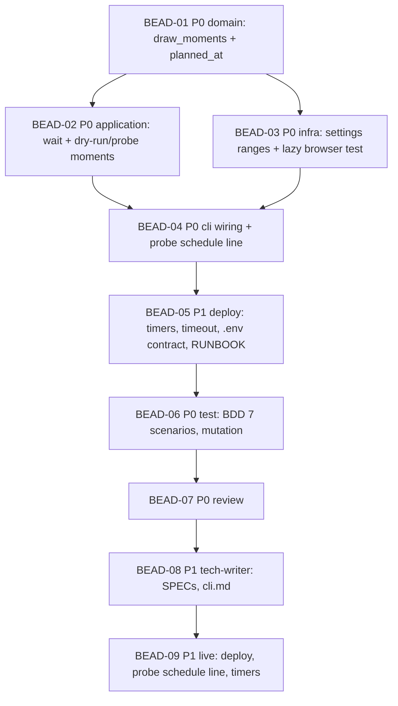

# PLAN: HT-003 — Random check-in and check-out moments inside ranges

> **Status:** Approved
> **Created:** 2026-10-20

---

**Parent bead:** ht-1vd

## Epic Description

A deterministic draw of the moments in the domain, the wait for the moment in the use case, a new
`.env` contract, the timers at the start of the ranges, BDD for the seven PRD scenarios, review, documentation,
a live check on the VPS.

## Dependency DAG

**Critical path:** BEAD-01 → BEAD-02 → BEAD-04 → BEAD-05 → BEAD-06 → BEAD-07 → BEAD-08 → BEAD-09

| Wave | Beads | Shared files |
|-------|-------|-------------|
| 1 | BEAD-01 | — |
| 2 | BEAD-02, BEAD-03 | none: `application/` against `infrastructure/`; no override needed, the nodes differ |
| 3 | BEAD-04 | `cli.py`, `application/probe.py` (the `schedule:` output) |
| 4 | BEAD-05 | `deploy/`, `.github/workflows/deploy.yml` |
| 5 | BEAD-06 → BEAD-07 → BEAD-08 → BEAD-09 | roles |

## Beads

Status lives in ACTIVE.md, reconciled from the tracker by the pre-commit active-sync, so this
table names the plan and carries no status. The Tracker cell holds `-` until the beads are
created, and then the id the tracker answered.

| ID | Tracker | Name | Priority | Depends On |
|----|---------|------|----------|------------|
| BEAD-01 | ht-ust | Domain: `TimeRange`, `DailyMoments`, `draw_moments`, `window_from`; `planned_at` in the report | P0 | - |
| BEAD-02 | ht-su5 | Application: the wait for the moment in `WindowedRun`; the moments of the day in `DryRun` | P0 | 01 |
| BEAD-03 | ht-4vm | Infrastructure: the ranges and the seed in `Settings`, rejection of the old windows; a test of the lazy browser start | P0 | 01 |
| BEAD-04 | ht-rat | CLI: wiring of the draw, `--force` without the wait, the `schedule:` line in `probe` | P0 | 02, 03 |
| BEAD-05 | ht-978 | Deploy: the timers 07:30/16:30, `TimeoutStartSec=60min`, the `.env` contract in deploy.yml, RUNBOOK | P1 | 04 |
| BEAD-06 | ht-slm | Test: the 7 PRD scenarios as BDD, coverage, mutations of the core | P0 | 05 |
| BEAD-07 | ht-evj | Review | P0 | 06 |
| BEAD-08 | ht-6l0 | Tech-writer: SPEC `schedule`, `windowed-run`, `probe`, `settings`; cli.md; architecture.md | P1 | 07 |
| BEAD-09 | ht-02r | Live check on the VPS: deploy, `probe` with the `schedule:` line, the first scheduled runs (the local agent / the owner) | P1 | 08 |

## Bead Details

### BEAD-01: Domain — the draw of the moments

**Priority:** P0 · **Depends on:** - · **Blocks:** BEAD-02, BEAD-03

**What to do:** in `domain/schedule.py` — `TimeRange`, `DailyMoments`, `draw_moments(day, seed,
checkin_range, session_length, extra_max, checkout_range)`, `window_from(moment, grace)`;
in `domain/report.py` — the field `planned_at: time | None` and its text in `render`. TDD: the range
bounds, determinism, different days → different minutes (on 30 consecutive dates at least two
different values), clipping to the end of the range, day length ≥ 9 h when it fits.

**Done when:**
- [ ] the unit tests are green and bite; `mutmut` on `domain/` with no surviving non-equivalent mutants
- [ ] an API CHANGE comment with the signatures for BEAD-02/03/04

### BEAD-02: Application — the wait for the moment

**Priority:** P0 · **Depends on:** BEAD-01 · **Blocks:** BEAD-04

**What to do:** `WindowedRun` accepts `moment` and `grace` (or `Window` + `moment`), before the
first attempt waits with `clock.sleep` until the moment if `now < moment`; `SKIP_EARLY` remains for
a start before the range start (passed as `range_start`). `DryRun.plan` names
the moments drawn for the day. The report receives `planned_at`.

**Done when:**
- [ ] tests: the wait exactly until the moment (fake clock), no wait when `now ≥ moment`,
      `--force` does not wait, the dry run prints the moments
- [ ] exactly one notification per run — as before

### BEAD-03: Infrastructure — settings and the lazy browser

**Priority:** P0 · **Depends on:** BEAD-01 · **Blocks:** BEAD-04

**What to do:** `Settings`: `HT_CHECKIN_RANGE`, `HT_CHECKOUT_RANGE`, `HT_SESSION_LENGTH_MINUTES`,
`HT_SESSION_EXTRA_MAX_MINUTES`, `HT_WINDOW_GRACE_MINUTES`, `HT_JITTER_SEED` (masked);
the old `HT_CHECKIN_WINDOW`/`HT_CHECKOUT_WINDOW` → `ConfigError` with a hint. A test on the
Playwright adapter: the browser is not started before `login()` (the constructor and `__enter__` do not call
`_launch`); if that is not so — fix it in the adapter.

**Done when:**
- [ ] `Settings` tests for all the new variables, the default values, rejection of the old names
- [ ] the lazy-start test is green and goes red under sabotage

### BEAD-04: CLI — wiring

**Priority:** P0 · **Depends on:** BEAD-02, BEAD-03 · **Blocks:** BEAD-05

**What to do:** `cli.py` wires `draw_moments(today)` → `window_from` → `WindowedRun`;
`--force` → the moment is "now"; `horizon probe` prints `schedule: today HH:MM / HH:MM`.

**Done when:**
- [ ] CLI tests through `CliRunner`: a normal run waits for the moment (fake clock), `--force` does not,
      `probe` prints the fifth line

### BEAD-05: Deploy — the timers and the `.env` contract

**Priority:** P1 · **Depends on:** BEAD-04 · **Blocks:** BEAD-06

**What to do:** the timers `07:30:00`/`16:30:00 Europe/Moscow`, `TimeoutStartSec=60min`;
`deploy.yml` writes the new variables (values from the RFC) and does not write the old ones; RUNBOOK §2.2, §5,
§6 and `tests/unit/deploy/` updated.

**Done when:**
- [ ] `systemd-analyze calendar` on both expressions; the unit-file and workflow tests are green
- [ ] `actionlint` rc 0

### BEAD-06: Test · **BEAD-07: Review** · **BEAD-08: Tech-writer**

As in HT-001: the seven PRD scenarios word for word, coverage and mutations; review with an empty launch
prompt (only the bead id); SPEC of the nodes `schedule`, `windowed-run`, `probe`, `settings`,
`docs/services/cli.md` (table of variables), `docs/architecture.md`.

### BEAD-09: Live check

**Priority:** P1 · **Depends on:** BEAD-08

**What to do:** after the PR merge the deploy writes a new `.env`; from the VPS `horizon probe` shows
the `schedule:` line with the moments of the day; `checkin --dry-run` names the same ones; the timers are enabled;
the owner watches the first scheduled runs in Telegram: different minutes on different days.

**Done when:**
- [ ] two scheduled days in a row with different check-in and check-out moments in the notifications
