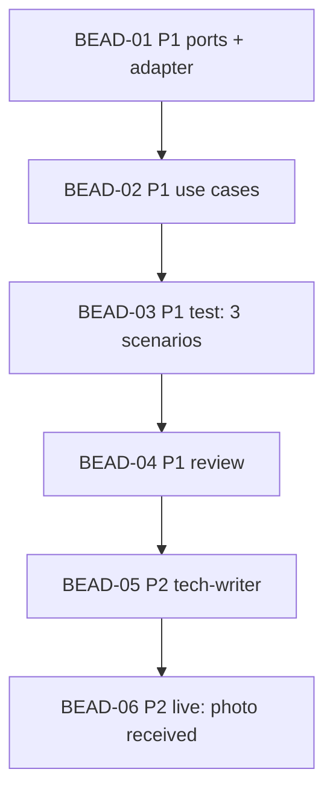

# PLAN: HT-004 — Screenshot in the notification of a successful check-in and check-out

> **Status:** Done
> **Created:** 2026-10-20

---

**Parent bead:** ht-2r9

## Epic Description

The port and the adapter hand out the path to the success screenshot, the use cases put it into the report, the three
PRD scenarios, review, documentation, a live check of the photo by the owner.

## Dependency DAG

**Critical path:** 01 → 02 → 03 → 04 → 05 → 06

## Beads

| ID | Tracker | Name | Priority | Depends On |
|----|---------|------|----------|------------|
| BEAD-01 | ht-ah3 | The `open_desktop`/`log_off` port → `Path \| None`; the adapter takes the success screenshot | P1 | HT-003 ht-slm, HT-005 ht-5ni |
| BEAD-02 | ht-owz | The use cases put the path into the report; fakes | P1 | 01 |
| BEAD-03 | ht-bm9 | Test: the three PRD scenarios, coverage | P1 | 02 |
| BEAD-04 | ht-2l1 | Review | P1 | 03 |
| BEAD-05 | ht-8i1 | Tech-writer: the SPEC of the ports, the adapter, the use cases | P2 | 04 |
| BEAD-06 | ht-2kp | Live check: the owner received the check-in and check-out photos | P2 | 05 |

## Bead Details

### BEAD-01
**What to do:** the port signatures; after «desktop opened» the adapter waits 2 s and takes
`_screenshot(RunKind.CHECKIN)`; after the list reload in `log_off` — `_screenshot(CHECKOUT)`;
a screenshot error → `None`, a log line by type. The fixture and the adapter tests.
**Done when:** the adapter tests on the fixture: the path is returned, the file exists, nothing is taken on `#/home`, a failure yields `None`.

### BEAD-02
**What to do:** `MorningCheckin`/`EveningCheckout` put the path into `RunReport.screenshot` on success; the client fake hands out the path.
**Done when:** unit tests: the success report carries the path; the failure report — as before.

### BEAD-03 … BEAD-06
As in HT-003: the scenarios word for word, the review with an empty launch prompt, the SPEC, the live check.
