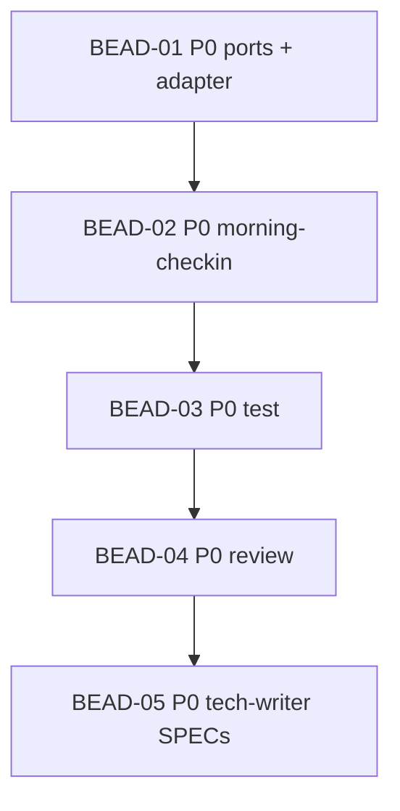

# PLAN: HT-009 — Check-in success screenshot after the hold

> **Status:** Approved
> **Created:** 2026-10-22

---

**Parent bead:** ht-qq2

## Epic Description

Split the check-in success screenshot from `open_desktop`, capture after the hold, cover the
PRD scenarios, refresh SPECs. After the tech-writer bead, the same branch bumps `1.0.1` and
opens one PR; the live photo check is after deploy.

## Dependency DAG

**Critical path:** 01 → 02 → 03 → 04 → 05

**Waves (`/coordinator`):** dev (01, 02) → test (03) → review (04) → tech-writer (05).

## Beads

Status lives in ACTIVE.md, reconciled from the tracker by the pre-commit active-sync, so this
table names the plan and carries no status. The Tracker cell holds `-` until the beads are
created, and then the id the tracker answered.

| ID | Tracker | Name | Priority | Depends On |
|----|---------|------|----------|------------|
| BEAD-01 | ht-22u | Port + adapter: `open_desktop -> None`, `capture_open_desktop` | P0 | - |
| BEAD-02 | ht-rqz | Morning check-in: capture after hold | P0 | 01 |
| BEAD-03 | ht-bic | Test: PRD scenarios, coverage, fakes | P0 | 02 |
| BEAD-04 | ht-7qx | Review | P0 | 03 |
| BEAD-05 | ht-o5u | Tech-writer: SPECs for ports, morning-checkin, horizon-playwright-client | P0 | 04 |

## Bead Details

### BEAD-01: Port + adapter

**Priority:** P0  
**Depends on:** —  
**Blocks:** BEAD-02

**What to do:** In `ports.py`, change `open_desktop` to return `None` and add
`capture_open_desktop() -> Path | None`. In `PlaywrightHorizonClient`, stop success
photography in `open_desktop`. Capture polls an element screenshot of the largest
canvas or video in `#canvas-container` until 8 of 1024 samples have `max(R,G,B) ≥ 24`,
bounded by `desktop_paint_ms` (60 s), and saves that PNG. A blank timeout or a
screenshot error returns `None`. Remove `success_settle_ms`. Update the fixture tests.

**Done when:**
- [ ] Adapter tests: open returns no success path; a black surface is not saved; a painted surface is saved; none on `#/home`; a screenshot error returns `None`
- [ ] mypy/ruff clean on touched files

### BEAD-02: Morning check-in

**Priority:** P0  
**Depends on:** BEAD-01  
**Blocks:** BEAD-03

**What to do:** `MorningCheckin._attempt`: open → `opened_at` → hold → `capture_open_desktop`
→ status → disconnect → confirm. `opened_at` is the return of `open_desktop`, before the
hold. The success report carries the capture path; a failed confirmation carries no
opened-desktop photo. Update the unit fake usage in checkin tests.

**Done when:**
- [ ] Unit tests: success report path comes from capture after hold; `at` is not after the hold; an unconfirmed check-in sends no opened-desktop photo

### BEAD-03: Test

**Priority:** P0  
**Depends on:** BEAD-02  
**Blocks:** BEAD-04

**What to do:** Acceptance scenario
`A successful check-in's screenshot is taken after the desktop was held` (call order on the
fake); keep the existing screenshot_preview scenarios green; coverage and mutations as the
project gate requires for the touched nodes.

**Done when:**
- [ ] All four PRD scenario names pass in the suite
- [ ] Coverage does not regress below the project's CI bar

### BEAD-04: Review

**Priority:** P0  
**Depends on:** BEAD-03  
**Blocks:** BEAD-05

**What to do:** Review role over the branch: port contract, capture before disconnect,
`opened_at` before the hold, no checkout regression, secrets/screenshot allowlist, doc
freshness flags for tech-writer.

**Done when:**
- [ ] Review findings posted to the bead; blockers fixed or deferred with owner note

### BEAD-05: Tech-writer

**Priority:** P0  
**Depends on:** BEAD-04  
**Blocks:** —

**What to do:** Update SPECs under `docs/` for `ports`, `morning-checkin`, and
`horizon-playwright-client` (and layer READMEs if stale). State the new port, capture
after the hold, and `opened_at` at `open_desktop`'s return. No edits outside `docs/`.

**Done when:**
- [ ] `beadloom sync-check` is clean for those ref ids
- [ ] The three SPECs match the code

## Landing (same PR, not a tech-writer bead)

After BEAD-05, on this branch: bump `pyproject.toml` to `1.0.1`, `uv lock`,
`beadloom setup-agentic-flow`, move `[Unreleased]` into `## [1.0.1] - <date>` (*Fixed*)
with compare links. One pull request, `ci-ok`, merge.

## After merge (owner)

1. Tag `v1.0.1` on `main` and push (`docs/guides/releasing.md`).
2. Wait for Release workflow deploy.
3. Live: `ht checkin --force` — non-black desktop photo in Telegram; mark PRD live checkbox.
