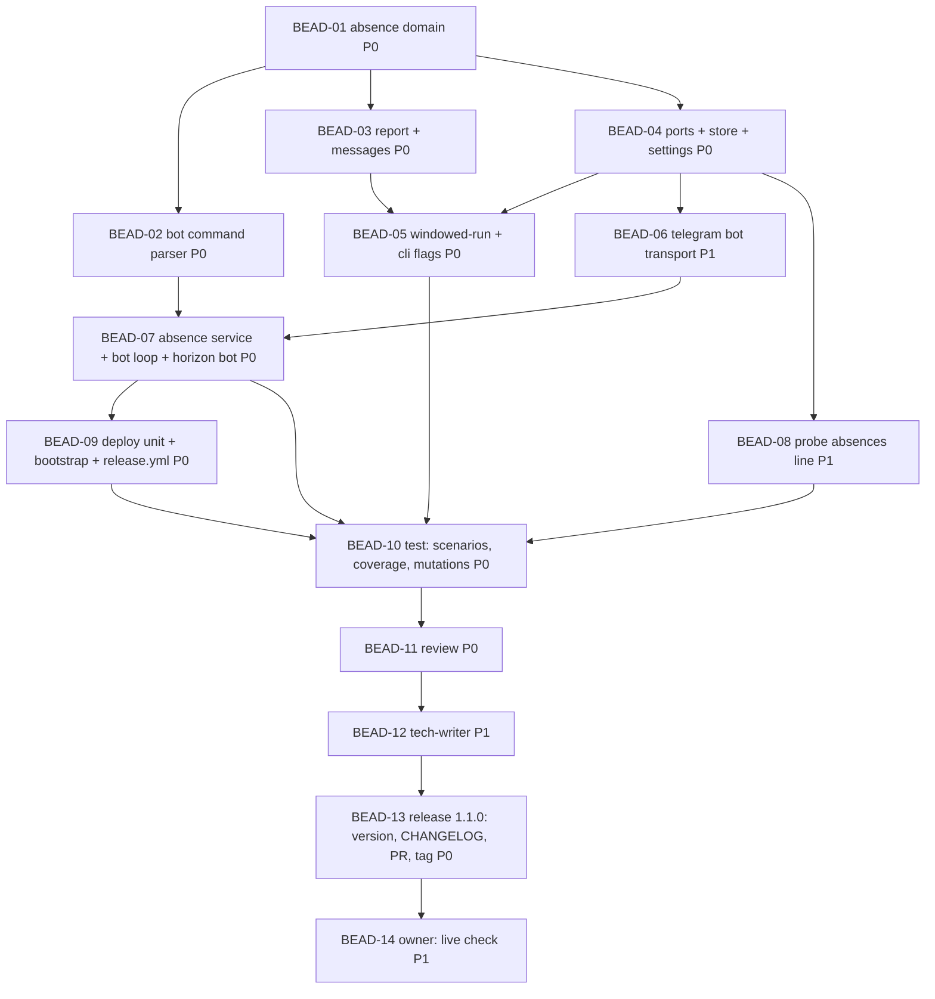

# PLAN: HT-012 — Absences through the bot, and one notice for a skipped day

> **Status:** Approved
> **Created:** 2026-10-24

---

## Epic Description

Absences entered through the bot and respected by the runs; one morning notice per
skipped day; the calendar line renamed; `horizon bot` as a systemd service installed by
the deploy; release `v1.1.0` together with HT-010.

## Dependency DAG

**Critical path:** BEAD-01 → BEAD-04 → BEAD-06 → BEAD-07 → BEAD-09 → BEAD-10 → BEAD-11 → BEAD-12 → BEAD-13

## Beads

Status lives in ACTIVE.md, reconciled from the tracker by the pre-commit active-sync, so this
table names the plan and carries no status. The Tracker cell holds `-` until the beads are
created, and then the id the tracker answered.

| ID | Tracker | Name | Priority | Depends On |
|----|---------|------|----------|------------|
| BEAD-01 | ht-162 | domain: `absence.py` — kinds, `Absence`, `covering`, `next_after`, `allocate_id`, `overlaps` | P0 | - |
| BEAD-02 | ht-koc | domain: `bot_commands.py` — the text command parser; `bot.*` catalogue keys | P0 | 01 |
| BEAD-03 | ht-4um | domain: `report.py` + `messages.py` — absence reasons, no time line for a day-level skip, the calendar line renamed; `production_calendar.feature` texts | P0 | 01 |
| BEAD-04 | ht-egg | ports `AbsenceStore`/`BotTransport`/`IncomingMessage`; `JsonAbsenceStore`; `Settings.state_dir` | P0 | 01 |
| BEAD-05 | ht-fzd | application: `WindowedRun` absence verdict first, `notify_day_skips`; CLI wires the store and the flag per command; `--dry-run` step | P0 | 03, 04 |
| BEAD-06 | ht-jc9 | infrastructure: `TelegramBotTransport` (long polling, reply), the redaction shared with the notifier | P1 | 04 |
| BEAD-07 | ht-xad | application: `AbsenceService`, `BotLoop`; CLI `horizon bot` | P0 | 02, 06 |
| BEAD-08 | ht-ekd | application: `probe` gains the `absences` check | P1 | 04 |
| BEAD-09 | ht-3lc | deploy: `horizon-bot.service`, `bootstrap.sh` (unit + state dir), `release.yml` installs and enables; contract tests | P0 | 07 |
| BEAD-10 | ht-h0l | test: the 10 scenarios real (`absences.feature`, `production_calendar.feature`), edge cases, coverage ≥ 80 %, domain mutants | P0 | 05, 07, 08, 09 |
| BEAD-11 | ht-3fz | review | P0 | 10 |
| BEAD-12 | ht-mr9 | tech-writer: six new SPECs and graph nodes checked, the changed SPECs, `cli.md`, `deployment.md`, RUNBOOK, README | P1 | 11 |
| BEAD-13 | ht-1t7 | release (coordinator): version `1.1.0`, CHANGELOG `[1.1.0]`, `uv lock`, `setup-agentic-flow`, PR, merge by the owner, tag `v1.1.0`, the Release run watched | P0 | 12 |
| BEAD-14 | ht-pwp | owner: the first absence entered through the bot on the host; the next morning notice | P1 | 13 |

## Bead Details

### BEAD-01: absence domain

**Priority:** P0 · **Depends on:** - · **Blocks:** 02, 03, 04

**What to do:** `src/horizon_tracker/domain/absence.py` per the RFC; tests in
`tests/unit/domain/test_absence.py`; the graph node `absence` under domain features with
a SPEC skeleton (`beadloom docs generate` or by hand) so `lint` and `sync-check` read it.

**Done when:**
- [ ] `Absence` refuses `last_day < first_day`; `covering` returns the first match by id; `allocate_id` is max + 1 and never reuses; `overlaps` is symmetric
- [ ] mutmut on the module: no surviving non-equivalent mutant
- [ ] an API CHANGE comment with the signatures for 02–04

### BEAD-02: bot command parser

**Priority:** P0 · **Depends on:** 01 · **Blocks:** 07

**What to do:** `src/horizon_tracker/domain/bot_commands.py`: `parse(text, today)`;
`Command` variants `Add`, `List`, `Delete`, `Edit`, `Help`; `CommandError(problem:
Message)`; dates `dd.mm`, `dd.mm.yyyy`, `yyyy-mm-dd`, ranges `a-b` / `a b`, kinds in
both languages; the `bot.*` keys (replies and errors) in `messages.py` in both languages
with the completeness test. Graph node `bot-commands`.

**Done when:**
- [ ] every error is a `Message` the catalogue holds; no raw text
- [ ] `dd.mm` without a year resolves to the next occurrence across the year boundary (tests on 30.12 and 02.01)
- [ ] mutation gate clean on the module

### BEAD-03: report and messages

**Priority:** P0 · **Depends on:** 01 · **Blocks:** 05

**What to do:** `Reason` gains the three absence reasons; `RunReport.absence`; `render`
drops the time line for a day-level skip, renames the calendar line, renders the absence
reason with its span; both languages; `production_calendar.feature` and the pytest-bdd
steps take the new text; the run-report tests in both languages.

**Done when:**
- [ ] success, failure, `TOO_EARLY` and `WINDOW_MISSED` reports render exactly as before except the calendar line
- [ ] the scenario `A skipped non-working day is reported without a time line` exists and passes
- [ ] mutation gate clean on `report.py`

### BEAD-04: ports, store, settings

**Priority:** P0 · **Depends on:** 01 · **Blocks:** 05, 06, 08

**What to do:** the two Protocols and `IncomingMessage` in `ports.py`;
`infrastructure/absence_store.py` (`JsonAbsenceStore`: missing file = empty; atomic write;
0600; parent 0700; a malformed file raises `AbsenceStoreError`); `Settings.state_dir`
from `HT_STATE_DIR` with its default; tests on `tmp_path`; the fake store in
`tests/support/fakes.py`. Graph node `absence-store`.

**Done when:**
- [ ] a write that fails leaves the previous file intact (the temp file is replaced only after a full write)
- [ ] the mode is checked by a test on `tmp_path`
- [ ] `horizon probe` is not yet touched (BEAD-08)

### BEAD-05: windowed-run and the CLI flags

**Priority:** P0 · **Depends on:** 03, 04 · **Blocks:** 10

**What to do:** `WindowedRun(..., store, notify_day_skips=True)`: the absence check
before the calendar, `SKIP_ABSENT` with the absence; a store that raises is logged by type
and read as empty; a day-level skip under `notify_day_skips=False` builds and logs the
report and does not call the notifier; forced runs ignore absences. The CLI passes the
store and `True` for `checkin`, `False` for `checkout`; `steps()` names the absence check.

**Done when:**
- [ ] the scenarios `A morning run on a day of vacation is skipped with the kind named`, `An evening run on a skipped day sends nothing`, `A day after the absence ends is a working day again` pass with real steps
- [ ] `TOO_EARLY` / `WINDOW_MISSED` of an evening run still notify (a test)
- [ ] no calendar call on an absence day (the fake calendar records none)

### BEAD-06: Telegram bot transport

**Priority:** P1 · **Depends on:** 04 · **Blocks:** 07

**What to do:** `infrastructure/telegram_bot.py`: `TelegramBotTransport(token, client)`
with `poll(offset)` (`getUpdates`, `timeout=30`, `allowed_updates=["message"]`) and
`reply(chat_id, text)` (`sendMessage`); non-200 and transport errors →
`BotTransportError`; the token redaction shared with `telegram.py` (moved to a module both
import, or imported from `telegram.py` — the dev records which and why). Tests on
`httpx.MockTransport`; a `caplog` test that the token never appears. Graph node
`telegram-bot`.

**Done when:**
- [ ] a 409 Conflict (another poller) is logged by status and raised as `BotTransportError`
- [ ] updates without a `message` or without `text` are skipped, not raised
- [ ] the token does not appear in any log line (test)

### BEAD-07: absence service, bot loop, `horizon bot`

**Priority:** P0 · **Depends on:** 02, 06 · **Blocks:** 09, 10

**What to do:** `application/absence_service.py` (`add` refuses an overlap naming the
id; `edit` keeps the id; `delete` of an unknown id answers not found; `list` renders every
absence with id, kind and dates); `application/bot_loop.py` (`run_once`, `run_forever`
with backoff on `BotTransportError`, the chat filter first, one reply per message, an
internal error becomes a reply and the loop continues); CLI `horizon bot`. Graph nodes
`absence-service`, `bot-loop`.

**Done when:**
- [ ] the scenarios of US-1 and US-2 pass with real steps (`absences.feature`)
- [ ] a message from another chat gets no reply and its text is not logged (test on `caplog`)
- [ ] `run_forever` survives three consecutive transport errors (test with a fake clock)

### BEAD-08: probe

**Priority:** P1 · **Depends on:** 04 · **Blocks:** 10

**What to do:** the check `absences` in `application/probe.py` with the three outcomes of
the RFC; `cli.md`'s output table row is BEAD-12's.

**Done when:**
- [ ] `horizon probe` exit code rules unchanged; the new line is informative on `ok`, `failed` on an unreadable file

### BEAD-09: deploy

**Priority:** P0 · **Depends on:** 07 · **Blocks:** 10

**What to do:** `deploy/horizon-bot.service`; `bootstrap.sh` adds the unit and creates the
state dir (0700, `horizon`); `release.yml` installs five units, `daemon-reload`,
`enable --now horizon-bot.service`, `try-restart` it, and the summary shows `systemctl
status horizon-bot.service`; the contract tests in `tests/unit/deploy/test_units.py`,
`test_bootstrap.py`, `test_release_workflow.py`.

**Done when:**
- [ ] `systemd-analyze verify`-style unit test passes; actionlint rc 0; shellcheck clean
- [ ] a sabotage removing the enable line goes red

### BEAD-10: test

**Priority:** P0 · **Depends on:** 05, 07, 08, 09 · **Blocks:** 11

**What to do:** every PRD scenario real, the edge cases of the RFC's risk table (the year
boundary, an absence starting today after the check-in range, a corrupt store), coverage
and the domain mutation gate on the tree.

**Done when:**
- [ ] `beadloom lint` reports no PRD scenario the suite lacks
- [ ] coverage ≥ 80 % (expected ≥ 98 %); mutmut on `domain/`: no surviving non-equivalent mutant

### BEAD-11: review

**Priority:** P0 · **Depends on:** 10 · **Blocks:** 12

**What to do:** `beadloom review-brief` per dev bead; the checklist of the role plus: the
chat filter is first and cannot be bypassed; the token never logs; the store write is
atomic; the evening silence covers only day-level skips; layering clean; the six new nodes
each carry one responsibility.

### BEAD-12: tech-writer

**Priority:** P1 · **Depends on:** 11 · **Blocks:** 13

**What to do:** SPECs of the six new nodes; the changed SPECs (run-report, messages,
windowed-run, probe, settings, telegram-notifier, ports); `docs/services/cli.md`
(`horizon bot`, the probe line, `HT_STATE_DIR`); `docs/guides/deployment.md` and
`deploy/RUNBOOK.md` (the unit, the state dir, the one-poller rule); README (what it does;
the bot); sync-check and docs audit clean.

### BEAD-13: release 1.1.0

**Priority:** P0 · **Depends on:** 12 · **Blocks:** 14

**What to do:** per `docs/guides/releasing.md`: `[project] version = "1.1.0"`,
`uv lock`, CHANGELOG `[1.1.0]` (Added: absences via the bot, `horizon bot`,
`horizon-bot.service`, `HT_STATE_DIR`, the probe line; Changed: the notices; Fixed: HT-010's
dialog and the capture follow-ups), `beadloom setup-agentic-flow`, `beadloom ci`, PR,
the owner merges, tag `v1.1.0` on the merge commit, the Release run watched, the GitHub
Release, `horizon probe` in the deploy summary, the portal.

### BEAD-14: owner live check

**Priority:** P1 · **Depends on:** 13

**What to do:** `/help`, `/add отгул <next working day>`, `/list` from the owner's chat;
the next morning: one notice with the reason and no logon; `/del`; the morning after:
a normal check-in. Record in ACTIVE.
