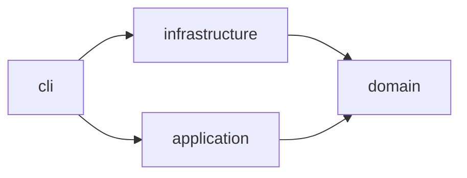

# horizon-tracker — Architecture

Scheduled check-in and check-out of a VMware Horizon VDI session, run on a VPS
under systemd timers. The project is one Python package laid out as a hexagon:
a pure domain, use cases over ports, adapters behind them, and a CLI that is the
composition root.

## Layers

| Node | Layer | Source | Responsibility |
|------|-------|--------|----------------|
| `cli` | service | `src/horizon_tracker/cli.py` | the `horizon` command; wires adapters into use cases |
| `infrastructure` | adapters | `src/horizon_tracker/infrastructure/` | Playwright driver for Horizon HTML Access, isdayoff.ru calendar, Telegram notifier, env config, system clock, artifact directory |
| `application` | application | `src/horizon_tracker/application/` | the shared run loop, the morning check-in, the evening check-out, the probe and the dry run |
| `domain` | domain | `src/horizon_tracker/domain/` | the daily draw of the check-in and check-out moments, the run windows built from them, working-day verdicts, session state, the run report, ports |

## Dependency direction

The domain depends on nothing. Adapters implement the ports the domain declares;
the rule `architecture-layers` in `.beadloom/_graph/rules.yml` holds this
direction and `beadloom lint --strict` reports a crossing. A feature node carries no
layer tag: it is `part_of` its layer node, and the rule reads its layer from there.

## Features

Every module of the three layers is one `kind: feature` node with a `SPEC.md`. The
nodes are declared in `.beadloom/_graph/{domain,application,infrastructure}-features.yml`;
the dependencies below are the imports the reindex derives, not authored edges.

| Feature | Layer | Module | Depends on |
|---------|-------|--------|------------|
| [`schedule`](domains/domain/features/schedule/SPEC.md) | domain | `schedule.py` | `working-day-calendar` |
| [`working-day-calendar`](domains/domain/features/working-day-calendar/SPEC.md) | domain | `calendar.py` | — |
| [`session-state`](domains/domain/features/session-state/SPEC.md) | domain | `session.py` | — |
| [`run-report`](domains/domain/features/run-report/SPEC.md) | domain | `report.py` | `schedule`, `working-day-calendar` |
| [`ports`](domains/domain/features/ports/SPEC.md) | domain | `ports.py` | `run-report`, `schedule`, `session-state` |
| [`windowed-run`](domains/application/features/windowed-run/SPEC.md) | application | `windowed_run.py` | `ports`, `run-report`, `schedule`, `working-day-calendar` |
| [`morning-checkin`](domains/application/features/morning-checkin/SPEC.md) | application | `checkin.py` | `windowed-run`, `ports`, `run-report`, `schedule`, `session-state` |
| [`evening-checkout`](domains/application/features/evening-checkout/SPEC.md) | application | `checkout.py` | `windowed-run`, `ports`, `run-report`, `schedule`, `session-state` |
| [`probe`](domains/application/features/probe/SPEC.md) | application | `probe.py` | `windowed-run`, `ports`, `schedule`, `working-day-calendar` |
| [`horizon-playwright-client`](domains/infrastructure/features/horizon-playwright-client/SPEC.md) | adapters | `horizon_playwright.py` | `ports`, `run-report`, `schedule`, `session-state` |
| [`isdayoff-calendar`](domains/infrastructure/features/isdayoff-calendar/SPEC.md) | adapters | `isdayoff.py` | — (implements `WorkingDayCalendar` structurally) |
| [`telegram-notifier`](domains/infrastructure/features/telegram-notifier/SPEC.md) | adapters | `telegram.py` | `run-report` |
| [`settings`](domains/infrastructure/features/settings/SPEC.md) | adapters | `config.py` | `schedule` |
| [`artifact-store`](domains/infrastructure/features/artifact-store/SPEC.md) | adapters | `artifacts.py` | `ports`, `schedule` |
| [`system-clock`](domains/infrastructure/features/system-clock/SPEC.md) | adapters | `clock.py` | — (implements `Clock` structurally) |

`cli` imports every adapter feature, `probe`, `ports`, `schedule`, `run-report` and
`working-day-calendar`, and the use cases through the `application` package.

## The two paths through the code

A scheduled run: the systemd timer starts `horizon checkin` or `horizon checkout` at
the start of its range (`HT_CHECKIN_RANGE` or `HT_CHECKOUT_RANGE`) → `cli` reads
`Settings`, builds the adapters and draws today's moments with `draw_moments()` → it
builds the run's window with `window_from()` from the run's own moment → `MorningCheckin`
or `EveningCheckout` hands its attempt to `WindowedRun` → `WindowedRun` asks the
calendar once, sleeps through `Clock.sleep` until the drawn moment, lets `decide()` rule
on each attempt, retries failures inside the window and sends one `RunReport` through
the `Notifier`. The report names the drawn moment beside the actual time.

A check without logging in: `horizon probe` asks the portal for its client bundles
(`HorizonClient.client_bundles()`), the calendar for today, and Chrome, once found at
its path, for its version (`HorizonClient.browser_version()`), and names the day's
drawn moments last. `--dry-run` plans the use case from `WindowedRun.first_decision()`
and the steps of the use case and the loop, names the same moments and the one the run
would wait until, and calls nothing on the Horizon client. The probe, a dry run and
both runs of one date draw the same pair, because the draw depends only on the date and
the seed.

## Source

`src/horizon_tracker/`

## Dependencies

- Runtime: Python 3.12, Playwright over the system Chrome, systemd timers on the VPS
- External services: VMware Horizon HTML Access (UAG), isdayoff.ru, Telegram Bot API
- Operations: `deploy/RUNBOOK.md` (Russian, the owner's operator document)
