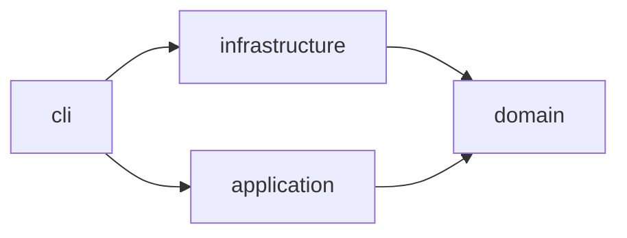

# horizon-tracker — Architecture

Scheduled check-in and check-out of a VMware Horizon VDI session, run on a VPS
under systemd timers. The project is one Python package laid out as a hexagon:
a pure domain, use cases over ports, adapters behind them, and a CLI that is the
composition root.

## Layers

| Node | Layer | Source | Responsibility |
|------|-------|--------|----------------|
| `cli` | service | `src/horizon_tracker/cli.py` | the `horizon` command; wires adapters into use cases |
| `infrastructure` | adapters | `src/horizon_tracker/infrastructure/` | Playwright driver for Horizon HTML Access, isdayoff.ru calendar, Telegram notifier, env config |
| `application` | application | `src/horizon_tracker/application/` | use cases: morning check-in, evening check-out |
| `domain` | domain | `src/horizon_tracker/domain/` | schedule windows, working-day verdicts, session state, ports |

## Dependency direction

The domain depends on nothing. Adapters implement the ports the domain declares;
the rule `architecture-layers` in `.beadloom/_graph/rules.yml` holds this
direction and `beadloom lint --strict` reports a crossing.

## Source

`src/horizon_tracker/`

## Dependencies

- Runtime: Python 3.12, Playwright over the system Chrome, systemd timers on the VPS
- External services: VMware Horizon HTML Access (UAG), isdayoff.ru, Telegram Bot API
