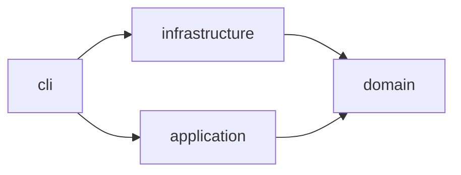

# horizon-tracker — Architecture

Scheduled check-in and check-out of a VMware Horizon VDI session, run on a VPS
under systemd timers, with a Telegram bot through which the owner enters absences. The project is one Python package laid out as a hexagon:
a pure domain, use cases over ports, adapters behind them, and a CLI that is the
composition root.

## Layers

| Node | Layer | Source | Responsibility |
|------|-------|--------|----------------|
| `cli` | service | `src/horizon_tracker/cli.py` | the `horizon` command; wires adapters into use cases |
| `infrastructure` | adapters | `src/horizon_tracker/infrastructure/` | Playwright driver for Horizon HTML Access, isdayoff.ru calendar, Telegram notifier, Telegram bot transport, absence store, env config, system clock, artifact directory |
| `application` | application | `src/horizon_tracker/application/` | the shared run loop, the morning check-in, the evening check-out, the probe and the dry run, the absence service and the bot loop |
| `domain` | domain | `src/horizon_tracker/domain/` | the daily draw of the check-in and check-out moments, the run windows built from them, working-day verdicts, session state, the owner's absences, the bot's command parser, the run report, the message catalogue, ports |

## Dependency direction

The domain depends on nothing. Adapters implement the ports the domain declares;
the rule `architecture-layers` in `.beadloom/_graph/rules.yml` holds this
direction and `beadloom lint --strict` reports a crossing. A feature node carries no
layer tag: it is `part_of` its layer node, and the rule reads its layer from there.

## Features

Every module of the three layers is one `kind: feature` node with a `SPEC.md`. The
nodes are declared in `.beadloom/_graph/{domain,application,infrastructure}-features.yml`;
the dependencies below are the imports the reindex derives, not authored edges.

| Feature | Layer | Module | Depends on |
|---------|-------|--------|------------|
| [`schedule`](domains/domain/features/schedule/SPEC.md) | domain | `schedule.py` | `messages`, `working-day-calendar` |
| [`working-day-calendar`](domains/domain/features/working-day-calendar/SPEC.md) | domain | `calendar.py` | — |
| [`session-state`](domains/domain/features/session-state/SPEC.md) | domain | `session.py` | — |
| [`absence`](domains/domain/features/absence/SPEC.md) | domain | `absence.py` | — |
| [`bot-commands`](domains/domain/features/bot-commands/SPEC.md) | domain | `bot_commands.py` | `absence`, `messages` |
| [`run-report`](domains/domain/features/run-report/SPEC.md) | domain | `report.py` | `absence`, `messages`, `schedule`, `working-day-calendar` |
| [`messages`](domains/domain/features/messages/SPEC.md) | domain | `messages.py` | — |
| [`ports`](domains/domain/features/ports/SPEC.md) | domain | `ports.py` | `absence`, `run-report`, `schedule`, `session-state` |
| [`windowed-run`](domains/application/features/windowed-run/SPEC.md) | application | `windowed_run.py` | `absence`, `messages`, `ports`, `run-report`, `schedule`, `working-day-calendar` |
| [`morning-checkin`](domains/application/features/morning-checkin/SPEC.md) | application | `checkin.py` | `windowed-run`, `messages`, `ports`, `run-report`, `schedule`, `session-state` |
| [`evening-checkout`](domains/application/features/evening-checkout/SPEC.md) | application | `checkout.py` | `windowed-run`, `messages`, `ports`, `run-report`, `schedule`, `session-state` |
| [`probe`](domains/application/features/probe/SPEC.md) | application | `probe.py` | `windowed-run`, `absence`, `absence-service`, `messages`, `ports`, `run-report`, `schedule`, `working-day-calendar` |
| [`absence-service`](domains/application/features/absence-service/SPEC.md) | application | `absence_service.py` | `absence`, `messages`, `ports`, `schedule` |
| [`bot-loop`](domains/application/features/bot-loop/SPEC.md) | application | `bot_loop.py` | `absence-service`, `bot-commands`, `messages`, `ports` |
| [`horizon-playwright-client`](domains/infrastructure/features/horizon-playwright-client/SPEC.md) | adapters | `horizon_playwright.py` | `ports`, `run-report`, `schedule`, `session-state` |
| [`isdayoff-calendar`](domains/infrastructure/features/isdayoff-calendar/SPEC.md) | adapters | `isdayoff.py` | — (implements `WorkingDayCalendar` structurally) |
| [`telegram-notifier`](domains/infrastructure/features/telegram-notifier/SPEC.md) | adapters | `telegram.py` | `messages`, `run-report` |
| [`telegram-bot`](domains/infrastructure/features/telegram-bot/SPEC.md) | adapters | `telegram_bot.py` | `ports`, `telegram-notifier` (the token discipline) |
| [`absence-store`](domains/infrastructure/features/absence-store/SPEC.md) | adapters | `absence_store.py` | `absence`, `ports` |
| [`settings`](domains/infrastructure/features/settings/SPEC.md) | adapters | `config.py` | `messages`, `schedule` |
| [`artifact-store`](domains/infrastructure/features/artifact-store/SPEC.md) | adapters | `artifacts.py` | `ports`, `schedule` |
| [`system-clock`](domains/infrastructure/features/system-clock/SPEC.md) | adapters | `clock.py` | — (implements `Clock` structurally) |

`cli` imports every adapter feature, `probe`, `absence-service`, `bot-loop`, `messages`,
`ports`, `schedule`, `run-report` and `working-day-calendar`, and the use cases through
the `application` package.

## The three paths through the code

A scheduled run: the systemd timer starts `horizon checkin` or `horizon checkout` at
the start of its range (`HT_CHECKIN_RANGE` or `HT_CHECKOUT_RANGE`) → `cli` reads
`Settings`, builds the adapters and draws today's moments with `draw_moments()` → it
builds the run's window with `window_from()` from the run's own moment → `MorningCheckin`
or `EveningCheckout` hands its attempt to `WindowedRun` → `WindowedRun` reads the
`AbsenceStore` once and, on a day an absence covers, skips without asking the calendar;
otherwise it asks the calendar once, sleeps through `Clock.sleep` until the drawn moment,
lets `decide()` rule on each attempt, retries failures inside the window and builds one
`RunReport`. It sends the report through the `Notifier`, except a day-level skip of the
evening run (a non-working day or an absence), which the morning run has already
reported. The report names the drawn moment beside the actual time, and a day-level skip
names no time.

The bot: `horizon-bot.service` runs `horizon bot` → `cli` builds `AbsenceService` over the
`JsonAbsenceStore` and `BotLoop` over the `TelegramBotTransport` → `BotLoop` long-polls
`getUpdates`, drops every chat but `TELEGRAM_CHAT_ID`, parses the owner's text with
`parse(text, today)` (`bot-commands`), has the absence service carry the command out
against `HT_STATE_DIR/absences.json`, and sends one reply per message through
`sendMessage`. The runs read the same file, so an absence entered now stops the next run
it covers.

A check without logging in: `horizon probe` asks the portal for its client bundles
(`HorizonClient.client_bundles()`), the calendar for today, Chrome, once found at its
path, for its version (`HorizonClient.browser_version()`), and the absence store for the
absences it holds, and names the day's drawn moments last. `--dry-run` plans the use case from `WindowedRun.first_decision()`
and the steps of the use case and the loop, names the same moments and the one the run
would wait until, and calls nothing on the Horizon client. The probe, a dry run and
both runs of one date draw the same pair, because the draw depends only on the date and
the seed.

## The language a person reads

Every text a person reads comes from the message catalogue in the domain
([`messages`](domains/domain/features/messages/SPEC.md)), in English or Russian: the
Telegram notification, the bot's replies, the lines of `horizon probe` and of a dry run,
and a configuration error. The use cases, the settings and the schedule never pick a language.
They hand out `Message` values, a catalogue key and its fields. `HT_LANGUAGE` (`en` by
default, `ru`) is read into `Settings.language`, and any other value stops every command
at start. The CLI renders the probe and dry-run lines in that language and builds the
`TelegramNotifier` with it, and the notifier renders each report with
`render(report, language)`. A configuration error is logged in English and, when the
configured language is another, also printed on stderr in that language. The logs are
always English: they are the operator's, whatever language the notifications use.

## Landscape

The service is bound to six systems outside this repository. Each is a graph node of kind
`service` with lifecycle `external`, declared in `.beadloom/_graph/landscape.yml`, and each
has a SPEC under `docs/domains/external/<node>/SPEC.md` that states in words the surface the
service reads or writes: the URLs, fields and status codes, the selectors, the variables,
the units, the files. An external node is not part of `horizon-tracker`, so it carries no
`part_of` edge and is listed in the `exclude` of the rule `service-needs-parent`.

| Contract (`protocol:name`) | Producer → consumer | What it binds |
|----------------------------|---------------------|---------------|
| `http:horizon-client-bundle` | [`horizon-portal`](domains/external/horizon-portal/SPEC.md) → `horizon-playwright-client` | the client bundle read without logging in, and the markup the adapter's selectors come from |
| `http:horizon-broker-session` | `horizon-portal` → `horizon-playwright-client` | the login, the launch items and `kill-session` over the broker's XML API |
| `blast:desktop-session` | `horizon-portal` → `horizon-playwright-client` | the WebSocket the check-in holds, whose closing is the disconnect |
| `http:isdayoff-day` | [`isdayoff`](domains/external/isdayoff/SPEC.md) → `isdayoff-calendar` | `GET /YYYYMMDD` answered with a one-character day code |
| `http:telegram-sendMessage` | [`telegram-bot-api`](domains/external/telegram-bot-api/SPEC.md) → `telegram-notifier`, `telegram-bot` | the text report, and the bot's reply to each of the owner's commands |
| `http:telegram-sendPhoto` | `telegram-bot-api` → `telegram-notifier` | the report with its screenshot |
| `http:telegram-getUpdates` | `telegram-bot-api` → `telegram-bot` | the long poll for the owner's text messages; one caller per bot, `horizon-bot.service` |
| `notification:run-report` | `telegram-notifier` → [`owner-chat`](domains/external/owner-chat/SPEC.md) | the report the owner reads, in `HT_LANGUAGE` |
| `command:bot-text` | `owner-chat` → `bot-commands` | the text of one command the owner types: `/add`, `/list`, `/edit`, `/del`, `/help` |
| `env:dot-env` | [`vps-host`](domains/external/vps-host/SPEC.md) → `settings` | every variable of the host's `.env` |
| `env:github-environment` | [`github-environment`](domains/external/github-environment/SPEC.md) → `vps-host` | the secrets and variables the Release's deploy writes into `.env` |
| `file:absences` | `vps-host` → `absence-store` | `HT_STATE_DIR/absences.json`, mode 0600, owner `horizon`: `{"last_issued": N, "absences": [...]}`, written atomically by the bot and read by the runs |
| `systemd:units` | `vps-host` → `cli` | the two timers and the two oneshot services that start `horizon`, and `horizon-bot.service`, which runs `horizon bot` |

**The map.** `beadloom docs site` writes these contracts into the portal's
`landscape.data.json`, and the portal's Landscape page draws them: the six external nodes,
the eight nodes of this package that sit at the other end, and one link per contract with
its verdict: thirteen contracts, all `confirmed`. `landscape-diagram` is the same map as a static Mermaid diagram. The portal is
rebuilt on every release, so the map shows the released tree.

**What the verdict rests on.** Every contract is declared from both ends: a `produces` edge
whose `src` is the producer and a `consumes` edge whose `src` is the consumer. The
reconciler reads the `src` of each edge as an endpoint, and `confirmed` means that both ends
are declared (`verdict_basis: presence`). Beadloom compares a declared surface only for the
protocols `amqp` and `graphql`, and none of the protocols here is one of them. The map
therefore shows each contract as a plain dependency with an empty surface, which the view
renders as "undeclared", never as an invented field list. A `confirmed` verdict says that
both ends are declared. It does not say that the code's calls match the SPEC. That match is
read by review against the code, and the SPEC under `docs/domains/external/` is where it is
written down.

## Source

`src/horizon_tracker/`

## Dependencies

- Runtime: Python 3.12, Playwright over the system Chrome, systemd timers and the bot's
  service on the VPS
- External systems: the Horizon portal (VMware Horizon HTML Access (UAG) and its broker),
  isdayoff.ru, the Telegram Bot API, the owner's chat, the VPS host and the GitHub
  Environment `horizon-vps`. Their contracts are in [Landscape](#landscape).
- Operations: [`docs/guides/deployment.md`](guides/deployment.md) (installing and running the service on a host)
